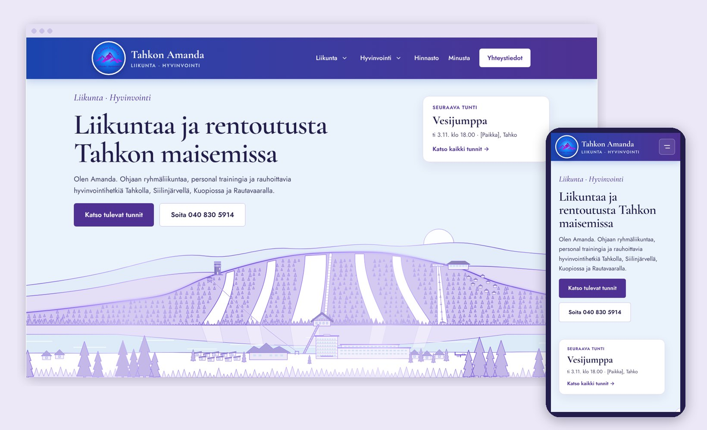

# Tahkon Amanda – verkkosivusto

[](https://github.com/PennasenKake/Liikunta_hyvinvointi_web/actions/workflows/ci.yml)

> **EN:** Website for a wellness and fitness business in Tahko, Finland. Built with Next.js 16, React 19, TypeScript and Tailwind CSS v4. Fully custom design with a hand-drawn SVG illustration of Tahko, scroll-driven animations and WCAG 2.1 AA accessibility. Lighthouse (desktop): 100 / 100 / 100 / 100. Covered by Playwright smoke tests and GitHub Actions CI. Content management (Sanity) and class schedule (Google Calendar) are in progress.

Responsiivinen verkkosivusto liikunta- ja hyvinvointipalveluita tarjoavalle Tahkon Amandalle.
Toiminta-alue: Tahko, Siilinjärvi, Kuopio ja Rautavaara.



🔗 **Sivusto:** tahkonamanda.fi *(julkaistaan myöhemmin)*
🔍 **Demo:** *(esikatseluversio tulossa)*

## Teknologiat

| Osa | Teknologia |
|---|---|
| Sovelluskehys | Next.js 16 (App Router, Server Components, Cache Components) |
| Käyttöliittymä | React 19, TypeScript |
| Tyylit | Tailwind CSS v4 (`@theme`-teema) |
| Testit | Playwright (savutestit), axe-core (saavutettavuus) |
| CI | GitHub Actions: tyyppitarkistus, ESLint, build ja testit jokaisesta pushista |
| Sisällönhallinta | Sanity *(tulossa)* |
| Tapahtumat | Google Calendar API *(tulossa)* |
| Instagram-syöte | Behold *(tulossa)* |

## Ominaisuudet

**Sivun osat**
- [x] Yläpalkki: pienenee ja piiloutuu vieritettäessä, palaa ylös vieritettäessä, alavalikot palveluihin, mobiilivalikko
- [x] Hero, joka täyttää ensimmäisen näkymän, ja oma SVG-kuvitus Tahkosta
- [x] Palvelut: Liikunta ja Hyvinvointi rinnakkain, mobiilissa avautuvat kuvaukset, suorat linkit palveluihin (`/#vesijumppa`)
- [x] Miksi liikkua, Hinnasto ja Minusta *(osin paikkamerkkisisältöä)*
- [x] Tulevat tunnit: lisäys omaan kalenteriin ja jakaminen *(esimerkkidata, Google-kalenteri tulossa)*
- [x] Instagram-karuselli nuolilla, pyyhkäisyllä ja näppäimistöllä *(väliaikaiset kuvat, Behold tulossa)*
- [x] Footer: sivusto, yhteystiedot, tietoa ja ehdot, kumppanit
- [x] Käyttöehdot, tietosuojaseloste, evästeasetukset ja saavutettavuusseloste *(luonnokset)*
- [x] Oma 404-sivu

**Liike**
- [x] Scroll reveal: sisältö liukuu näkyviin vieritettäessä
- [x] Vuoristoviiva osioiden välissä: osioiden raja on vuoren siluetti, jonka harjanteelle viiva piirtyy vasemmalta oikealle vierityksen tahdissa

**Laatu**
- [x] Saavutettavuus WCAG 2.1 AA: axe-core 0 löydöstä kaikilla sivuilla, Siirry sisältöön -linkki, näppäimistötuki
- [x] 24 Playwright-savutestiä (48 ajoa työpöytä- ja mobiiliprofiililla), ajetaan CI:ssä

**Hakukoneet ja jakaminen**
- [x] Paikallinen SEO: LocalBusiness-rakennetieto palvelualueineen (Tahko, Siilinjärvi, Kuopio, Rautavaara) ja palveluineen, paikkakunnat sivun otsikossa
- [x] `sitemap.xml`, `robots.txt`, canonical-osoitteet ja `metadataBase`
- [x] Open Graph -jakokuva (1200 × 630) somea ja viestisovelluksia varten
- [x] Esikatselutila: `NEXT_PUBLIC_NOINDEX=1` pitää testiversion pois hakukoneista

**Tulossa**
- [ ] Sisällön muokkaus kirjautumalla (Sanity Studio)
- [ ] Google-kalenterin tunnit, Behold-Instagram-syöte ja verkkoajanvaraus

## Tekniset ratkaisut

**Server Components oletuksena.** Valtaosa sivusta renderöidään palvelimella HTML:ksi, eikä selaimeen lähetetä niille JavaScriptiä. Client Componentteja ovat vain osat, joissa on tilaa tai selaimen rajapintoja: yläpalkin vierityslogiikka (`HeaderShell`), alavalikot, mobiilivalikko, palvelurivin avautuminen, Instagram-karuselli, jakopainike ja paljastusanimaatio. Esimerkiksi yläpalkin sisältö renderöidään palvelimella, ja `HeaderShell` käärii sen ja hoitaa vain vierityksen.

**Data erillään näkymästä.** Palvelut, hinnat, kalenteri, kuvat, Instagram-julkaisut ja yhteystiedot ovat `web/src/lib/`-kansiossa. Komponentit vain näyttävät datan. Uusi palvelu ilmestyy automaattisesti sekä Palvelut-osioon että yläpalkin alavalikkoon. Kun sisältö siirtyy Sanityyn ja Google-kalenteriin, muutokset tehdään `lib/`-tiedostoihin.

**Välimuisti valmiina rajapinnoille.** Kalenterihaku käyttää Next.js 16:n `"use cache"`-direktiiviä. Kaikki sivut ovat staattisia, ja etusivu päivittyy välimuistista 15 minuutin välein, joten Google Calendar API:a ei kutsuta jokaisella sivulatauksella.

**Animaatiot, jotka eivät riko mitään.**
- Vuoristoviiva on pelkkää CSS:ää (`animation-timeline: view()` ja `pathLength="1"`). Selaimissa, jotka eivät tue vierityssidonnaisia animaatioita, viiva näkyy valmiina.
- Scroll reveal piilottaa sisällön vasta, kun `<head>`-skripti on lisännyt `has-js`-luokan. Ilman JavaScriptiä kaikki näkyy.
- Kaikki liike jätetään pois, jos käyttäjä on pyytänyt laitteeltaan vähemmän liikettä (`prefers-reduced-motion`).

**Saavutettavuus rakenteessa, ei jälkikäteen.**
- Semanttinen HTML: `<dl>` hinnastossa, `<address>` yhteystiedoissa, `<time>` tapahtumissa, alueet ja otsikkohierarkia
- Alavalikot WAI-ARIA Disclosure -mallilla (hiiri, näppäimistö, kosketus, Esc), yläpalkki ei piiloudu, kun fokus on siinä
- Samannimisille linkeille saavutettava nimi (`Katso tunnit: Vesijumppa`), näkyvä fokusrengas, kosketusalueet vähintään 44 px
- Kaikkien värien kontrasti tarkistettu: teksti 6,8–9,6:1 (AA vaatii 4,5:1)

**Suorituskyky.** Lighthouse työpöydällä: suorituskyky, saavutettavuus, parhaat käytännöt ja SEO 100/100. Mobiilissa (hidastettu 4G ja suoritin) suorituskyky on 76 ja muut 100. Fontit ladataan `next/font`-työkalulla omalta palvelimelta, eikä kävijän selain tee pyyntöjä Googleen. Kuvat optimoidaan `next/image`-komponentilla WebP-muotoon näytön koon mukaan. Etusivun kokonaiskoko on noin 570 kt, josta valtaosa on valokuvia.

**Oma visuaalinen identiteetti.** Tahko-kuvitus on piirretty SVG:nä generaattoriskriptillä. Kuvituksessa ovat Tahkovuoren rinteet, näkötorni ja Suomen pisin zipline, Tahkon portaat ja niiden päässä Tirol-ravintola, Panorama-tuolihissi ja -metsäkylpylä, Tahkolahti, ponttonisilta, Sokos-hotelli sekä ranta- ja mökkikylä. Kuva on 2400 px leveä, jotta koko maisema näkyy leveälläkin näytöllä. Värit ja fontit on määritelty yhteen paikkaan Tailwind v4:n `@theme`-lohkoon.

**Hakukoneoptimointi yhdestä lähteestä.** Rakennetieto (`lib/seo.ts`) muodostetaan samasta datasta kuin sivun sisältö (`site.ts`, `services.ts`), joten Googlelle kerrotut palvelut ja palvelualueet pysyvät aina samoina kuin sivulla. `robots.txt` ja `sitemap.xml` ovat Next.js:n tiedostokonventioita (`app/robots.ts`, `app/sitemap.ts`), ja sivuston osoite tulee ympäristömuuttujasta `NEXT_PUBLIC_SITE_URL`.

**Aikavyöhykkeet.** Kellonajat muotoillaan aina `Europe/Helsinki`-aikavyöhykkeellä, joten ne näkyvät oikein, vaikka palvelin olisi ulkomailla.

## Hakemistorakenne

```
├── web/                Next.js-sivusto
│   ├── e2e/            Playwright-savutestit
│   └── src/
│       ├── app/        Reitit: etusivu, 404, käyttöehdot, tietosuoja, evästeet, saavutettavuus
│       ├── components/ layout/ (yläpalkki, footer) · sections/ (etusivun osiot) · ui/ (palikat)
│       └── lib/        Data ja apufunktiot
├── materiaalit/        Logo ja kuvitus (lähdetiedostot)
├── docs/               Projektin dokumentaatio
└── .github/workflows/  CI
```

Tarkempi rakenne ja tiedostojen tila: [docs/hakemistorakenne.md](docs/hakemistorakenne.md).
Asiakkaalta odotettava sisältö: [docs/sisalto.md](docs/sisalto.md).

## Käynnistys paikallisesti

Vaatimukset: Node.js 20.9 tai uudempi.

```bash
cd web
npm install
npm run dev
```

Sivu aukeaa osoitteeseen http://localhost:3000.

| Komento | Tarkoitus |
|---|---|
| `npm run dev` | Kehityspalvelin |
| `npm run check` | Tyyppitarkistus ja ESLint (aja ennen committia) |
| `npm run build` | Tuotantobuild |
| `npm run start` | Tuotantobuildin ajaminen paikallisesti |
| `npm run test:e2e` | Savutestit selaimessa (tekee buildin itse) |

**Savutestit** ([`web/e2e/`](web/e2e/)) ajetaan työpöytä- ja mobiiliprofiililla. Ne tarkistavat, että:
- etusivu latautuu ilman virheitä, rikkinäisiä resursseja ja vaakavieritystä
- navigaatio, alavalikot, mobiilivalikko ja yläpalkin piiloutuminen toimivat
- palvelut näkyvät oikeissa palstoissa ja kuvaukset avautuvat mobiilissa
- Instagram-karusellin nuolet toimivat
- ohituslinkki ja vuoristoviiva toimivat (myös vähennetyn liikkeen kanssa)
- tietosivut latautuvat ja olematon osoite palauttaa tilakoodin 404
- `robots.txt`, `sitemap.xml`, rakennetieto, jakokuva ja canonical-osoitteet ovat kunnossa

Ennen ensimmäistä ajoa asenna testiselain: `npx playwright install chromium`.

GitHub Actions ajaa tarkistuksen, buildin ja savutestit automaattisesti jokaisesta pushista ja pull requestista ([`.github/workflows/ci.yml`](.github/workflows/ci.yml)). Jos testit epäonnistuvat, HTML-raportti tallentuu ajon Artifacts-osioon.

## Ympäristömuuttujat

Sivusto toimii toistaiseksi ilman ympäristömuuttujia. Integraatioita varten kopioi
[`web/.env.example`](web/.env.example) tiedostoksi `web/.env.local` ja täytä arvot.
`.env.local` ei koskaan mene versionhallintaan.

## Oikeudet

Koodi on julkisesti nähtävissä portfoliotarkoituksessa.
Logo, tekstit, kuvat ja kuvitukset ovat Tahkon Amandan omaisuutta,
eikä niitä saa käyttää ilman lupaa. Tarkemmin: [LICENSE](LICENSE).

## Tekijä

Eero Korhonen – [github.com/PennasenKake](https://github.com/PennasenKake)
