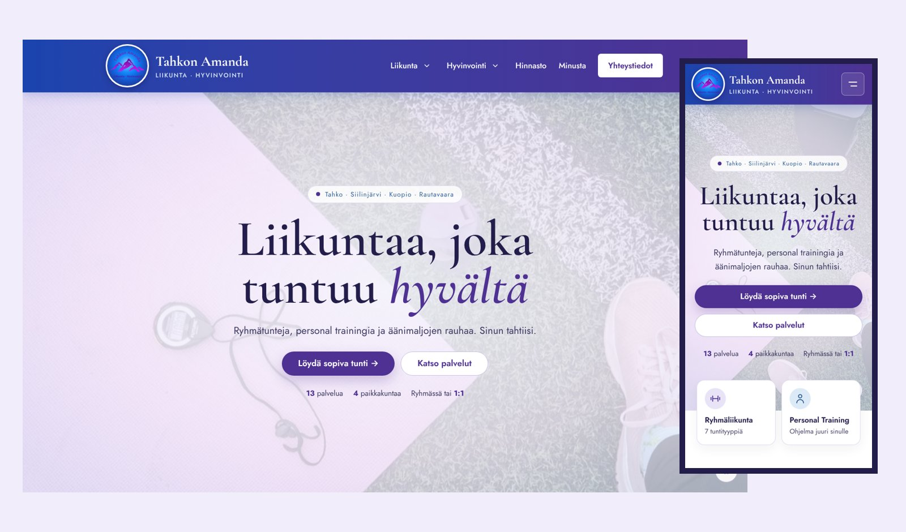

# Tahkon Amanda – verkkosivusto

[](https://github.com/PennasenKake/Liikunta_hyvinvointi_web/actions/workflows/ci.yml)

> **EN:** Website for a wellness and fitness business in Tahko, Finland. Built with Vite, React 19, TypeScript and Tailwind CSS v4, with every page prerendered to static HTML at build time (no server needed). Custom design with a hand-drawn SVG illustration of Tahko, scroll-driven animations and WCAG 2.1 AA accessibility. Covered by Vitest unit tests, Playwright smoke tests and GitHub Actions CI.

Responsiivinen verkkosivusto liikunta- ja hyvinvointipalveluita tarjoavalle Tahkon Amandalle.
Toiminta-alue: Tahko, Siilinjärvi, Kuopio ja Rautavaara.



🔗 **Sivusto:** tahkonamanda.fi *(julkaistaan myöhemmin)*
🔍 **Testiversio:** [pennasenkake.github.io/Liikunta_hyvinvointi_web](https://pennasenkake.github.io/Liikunta_hyvinvointi_web/) *(GitHub Pages, ei hakukoneissa)*

## Teknologiat

| Osa | Teknologia |
|---|---|
| Build | Vite 8 + esirenderöinti (`entry-server.tsx` + `scripts/prerender.mjs`) |
| Käyttöliittymä | React 19, TypeScript |
| Tyylit | Tailwind CSS v4 (`@theme`-teema), omat fontit `@fontsource`-paketeista |
| Testit | Vitest (yksikkötestit), Playwright (savutestit) |
| Laatu | oxlint, `tsc`-tyyppitarkistus |
| CI ja julkaisu | GitHub Actions: tarkistukset ja testit, testiversio GitHub Pagesiin |

## Ominaisuudet

**Sivun osat**
- [x] Yläpalkki: pienenee ja piiloutuu vieritettäessä, alavalikot palveluihin, mobiilivalikko
- [x] Hero kolmena versiona (A, B, C), valinta yhdellä asetuksella
- [x] Palvelut: Liikunta ja Hyvinvointi rinnakkain, mobiilissa avautuvat kuvaukset, suorat linkit palveluihin (`/#vesijumppa`)
- [x] Miksi liikkua, Hinnasto ja Minusta *(osin paikkamerkkisisältöä)*
- [x] Tulevat tunnit: lisäys omaan kalenteriin ja jakaminen *(esimerkkidata)*
- [x] Instagram-karuselli nuolilla, pyyhkäisyllä ja näppäimistöllä *(väliaikaiset kuvat)*
- [x] Alatunniste, jonka yläreunassa piirretty Tahko-maisema
- [x] Käyttöehdot, tietosuojaseloste, evästeasetukset ja saavutettavuusseloste *(luonnokset)*
- [x] Oma 404-sivu

**Hakukoneet ja jakaminen**
- [x] Jokainen sivu valmiina HTML:nä: Google näkee sisällön ilman JavaScriptiä
- [x] Sivukohtainen otsikko, kuvaus, canonical-osoite ja Open Graph -jakokuva
- [x] LocalBusiness-rakennetieto palvelualueineen ja palveluineen
- [x] `sitemap.xml` ja `robots.txt` buildissa, esikatselutila (`VITE_NOINDEX=1`)

**Laatu**
- [x] Saavutettavuus WCAG 2.1 AA: ohituslinkki, näppäimistötuki, kontrastit, liikkeen pysäytys ja `prefers-reduced-motion`
- [x] Ei evästeitä, ei seurantaa, ei pyyntöjä kolmansille osapuolille (fontit omina tiedostoina)

**Tulossa**
- [ ] Sisällön muokkaus kirjautumalla (Git-pohjainen CMS, esim. Sveltia)
- [ ] Google-kalenterin tunnit ja Instagram-syöte
- [ ] Tuotantojulkaisu omaan verkkotunnukseen

## Miten sivu rakentuu

`npm run build` tekee neljä vaihetta peräkkäin:

1. `tsc -b` tarkistaa tyypit
2. `vite build` rakentaa selainversion kansioon `dist/`
3. `vite build --ssr src/entry-server.tsx` rakentaa saman Reactin Node.js-versioksi
4. `scripts/prerender.mjs` renderöi jokaisen reitin (`src/routes.tsx`) valmiiksi HTML:ksi:
   `dist/index.html`, `dist/tietosuoja/index.html` jne., sekä `404.html`, `sitemap.xml` ja `robots.txt`

Selaimessa React "herättää" valmiin HTML:n eloon (hydraatio). Palvelinta ei tarvita, joten sivun voi julkaista
mihin tahansa staattiseen hostingiin (GitHub Pages, Cloudflare Pages, Netlify).

## Hakemistorakenne

```
├── site/                  Sivusto (Vite + React)
│   ├── e2e/               Playwright-savutestit
│   ├── public/            Kuvat, logo, Tahko-kuvitus, ikonit, jakokuva
│   ├── scripts/           prerender.mjs, build-pages.mjs, serve.mjs
│   └── src/
│       ├── routes.tsx     Sivut, otsikot ja kuvaukset
│       ├── pages/         Etusivu, lakisivut ja 404
│       ├── components/    layout/ · sections/ (hero/: A, B, C) · ui/
│       └── lib/           Sisältö ja apufunktiot
├── materiaalit/           Logo ja kuvitus (lähdetiedostot)
├── docs/                  Dokumentaatio
└── .github/workflows/     CI ja GitHub Pages
```

Tarkempi rakenne: [docs/hakemistorakenne.md](docs/hakemistorakenne.md).
Asiakkaalta odotettava sisältö: [docs/sisalto.md](docs/sisalto.md).

## Käynnistys paikallisesti

Vaatimukset: Node.js 22.12 tai uudempi.

```bash
cd site
npm install
npm run dev
```

Sivu aukeaa osoitteeseen http://localhost:5173.

| Komento | Tarkoitus |
|---|---|
| `npm run dev` | Kehityspalvelin |
| `npm run check` | Tyyppitarkistus, oxlint ja yksikkötestit (aja ennen committia) |
| `npm run build` | Tuotantobuild ja esirenderöinti (`dist/`) |
| `node scripts/serve.mjs` | Tarjoilee `dist/`-kansion kuten oikea hosting, http://localhost:4173 |
| `npm run test:e2e` | Savutestit selaimessa (tekee buildin itse) |
| `npm run build:pages` | Build GitHub Pages -testiversiota varten |

Ennen ensimmäistä savutestien ajoa asenna testiselain: `npx playwright install chromium`.

**Hero-versio** valitaan tiedostossa `site/src/lib/site.ts`: `heroVariant: "a" | "b" | "c"`
(a = tumma tekstilaatikko, b = sulautuvat kuvat, c = liikkuva tausta).

**Savutestit** ([`site/e2e/`](site/e2e/)) ajetaan työpöytä- ja mobiiliprofiililla. Ne tarkistavat mm. että
etusivu latautuu ilman virheitä ja vaakavieritystä, navigaatio ja mobiilivalikko toimivat, tietosivut latautuvat,
olematon osoite palauttaa 404:n ja `robots.txt`, `sitemap.xml`, rakennetieto ja canonical-osoitteet ovat kunnossa.

GitHub Actions ajaa tarkistukset, buildin ja savutestit jokaisesta pushista ja pull requestista
([`ci.yml`](.github/workflows/ci.yml)) ja julkaisee testiversion GitHub Pagesiin ([`pages.yml`](.github/workflows/pages.yml)).

## Ympäristömuuttujat

Sivusto toimii ilman ympäristömuuttujia. Malli: [`site/.env.example`](site/.env.example).
Vite päästää selaimeen vain `VITE_`-alkuiset muuttujat, joten niihin ei koskaan laiteta salaisuuksia.

## Oikeudet

Koodi on julkisesti nähtävissä portfoliotarkoituksessa.
Logo, tekstit, kuvat ja kuvitukset ovat Tahkon Amandan omaisuutta,
eikä niitä saa käyttää ilman lupaa. Tarkemmin: [LICENSE](LICENSE).

## Tekijä

Eero Korhonen – [github.com/PennasenKake](https://github.com/PennasenKake)
